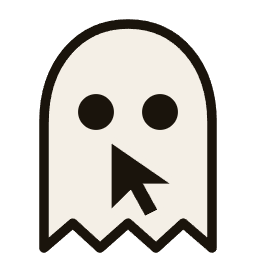
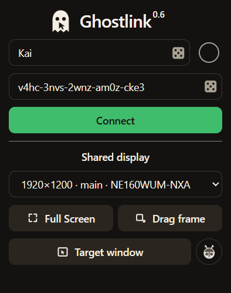

# Ghostlink



Ghostlink shows the other person's pointer on your screen when you both use the same secret. When they click, that pointer blinks, then returns to its color. Your own pointer stays where you put it.



## Connect

1. Choose a username and a secret (or generate them with the dice), then share the secret with the other person.
2. Both people click **Connect**. Ghostlink looks for the other person for one minute.
3. When connected, the indicator turns green and the button says Connected.

Secrets need at least 6 characters, not counting spaces or hyphens. The dice generates a 20-character secret in five groups of four. Both people must enter the same secret, including its internal spaces and hyphens.

## Setting the shared area

Your friend's pointer appears inside the selected rectangle on your screen. Your pointer is shared only while it is inside your own rectangle.

- Click **Full Screen** to use the whole display.
- Click **Drag frame**, then drag a rectangle.
- Click **Pick window**, move the pointer over a window, and wait through the countdown. The rectangle becomes that window.

## Test your pointer

Click the bug button to open a private test trackpad. Move or click inside it to control a colored **Test user** pointer in your selected shared area. Close the window to end the test.

Indicators blink while connecting, turn green when connected, and turn red if the check fails. **Relays** checks the handshake servers; **Test peer** checks the connection to your main panel. This local test does not check another computer's network.

`npm run test:link` builds and checks the two local peers through real signaling servers, verifies movement/clicks in a selected area, and checks that closing the test preserves the area and normal connection state. It needs a Windows desktop and internet access.

## Build

On Windows, from this folder:

```
npm install
npm run build:win
```

That writes `dist/Ghostlink-x.x.x-windows-setup.exe`. Run the installer, then open Ghostlink. Installed builds check GitHub Releases for updates after launch; when an update is ready, use **Restart and update** in the control panel.

Choose a folder on the first setup screen, then click **Install**. The default is your user AppData Programs folder. When installation finishes, choose **Close** or **Start the app** on the progress screen. Desktop and Start menu shortcuts are also available. To uninstall, use Windows Installed apps or `Uninstall Ghostlink.exe` in the installation folder.

`npm run dev` runs Ghostlink from source.

The separate [Windows Tauri prototype](docs/tauri-prototype.md) tests local pointer capture and the overlay. The build and release commands above still use Electron.

## Release

Set the version in `package.json`, commit the change, and push a matching tag such as `v0.7.0`. The Windows release workflow runs the tests and production build, creates the NSIS installer and update metadata, uploads them to a draft GitHub Release, then publishes the release after every artifact is present.

The installer remains unsigned until the `CSC_LINK` and `CSC_KEY_PASSWORD` GitHub Actions secrets are configured, so Windows may show a SmartScreen warning. Code-signing credentials must never be included in the application or repository.
